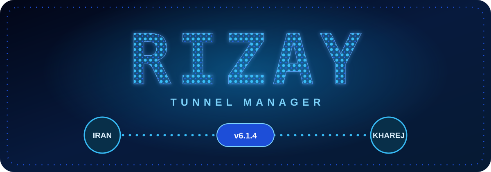

# RIZAY Tunnel Manager v5.1.0

نصب مرحله‌به‌مرحله GRE و GOST بین `IRAN` و `KHAREJ`؛ با پنل عددی آبی و پورت‌های جداشده با `,`.

## راهنمای فارسی

### فقط یک‌بار این دستور را روی هر سرور بزن

```bash
curl -fsSL https://raw.githubusercontent.com/rizay041/gre-manager/main/quick-install.sh | sudo bash
```

نصاب برنامه را دانلود و checksum را بررسی می‌کند، پیش‌نیازها را نصب می‌کند و این پنل را باز می‌کند:

```text
1) IRAN - setup IPs and comma-separated ports
2) KHAREJ - setup the destination server
3) Add or change ports
4) Status and saved ports
5) Health Center - packet loss and Doctor
6) Port Manager
7) Tunnel Center - start / stop / restart
8) Maintenance and optimization
9) About RIZAY / @rizay_041
0) Exit
```

### اول روی سرور KHAREJ

1. عدد `2` را بزن.
2. IP عمومی سرور `IRAN` را وارد کن.
3. IP عمومی همین سرور `KHAREJ` را وارد کن.
4. مشخصات را ببین و با عدد `1` نصب را تأیید کن.

تمام! GRE روی مقصد راه می‌افتد. پورت‌ها را در مرحله بعد روی سرور ایران تعیین می‌کنی؛ سرویس اصلی باید روی پورت موردنظر سرور خارج در حال اجرا باشد.

### بعد روی سرور IRAN

1. عدد `1` را بزن.
2. IP عمومی `IRAN` را وارد کن.
3. IP عمومی `KHAREJ` را وارد کن؛ همان IPهایی که در سمت مقابل دادی.
4. پورت‌ها را یک‌جا و با کامای انگلیسی بنویس؛ مثلاً `443,8443,2053`.
5. پروتکل را انتخاب کن: `1` برای TCP، `2` برای UDP، `3` برای هر دو.
6. روش انتقال را انتخاب کن: `1` برای GOST مستقیم، `2` برای GOST داخل GRE، `3` برای GRE و iptables.
7. خلاصه را بررسی کن و با عدد `1` تأیید کن.

همه پورت‌ها خودکار ذخیره و فعال می‌شوند. لازم نیست برای هر پورت دستور جداگانه بنویسی. در نصب اولیه، شماره پورت ایران و خارج یکسان است؛ مثلاً `443` ایران به `443` خارج می‌رود. GRE هم روی هر دو سرور برقرار می‌شود.

### پورت بیشتری می‌خوای؟

هر وقت خواستی پنل را باز کن:

```bash
sudo gre-manager
```

روی `IRAN` گزینه `3` را انتخاب کن و پورت‌ها را با `,` وارد کن. برای پورت‌های `KHAREJ` فقط Enter بزن تا همان شماره‌ها استفاده شوند؛ یا یک لیست هم‌تعداد به‌ترتیب وارد کن. مثال: `443,2053` در ایران و `8443,8080` در خارج یعنی انتقال `443 → 8443` و `2053 → 8080`.

پورت‌های دیگر حفظ می‌شوند. اگر پورت انتخابی قبلاً تنظیم شده باشد، همان Rule به‌روزرسانی می‌شود. هر پروتکل/پورت هم‌زمان به یک موتور تعلق دارد؛ تغییر روش انتقال، Rule همان پورت را بین GOST و GRE جابه‌جا می‌کند.

### بررسی وضعیت و کیفیت

- گزینه `4`: وضعیت سرویس‌ها و لیست پورت‌ها.
- گزینه `5`: Packet Loss، RTT، Jitter، تست TCP و Doctor.
- گزینه `6`: حذف یا مدیریت پورت‌ها.
- گزینه `7`: Start، Stop و Restart.
- گزینه `8`: Repair و بهینه‌سازی اختیاری شبکه.

امتیاز آمادگی یک گزارش تشخیصی است. برای مقایسه دوطرفه، Health را روی هر دو سرور اجرا کن. تنظیمات پیش‌فرض GRE: `10.77.0.1/30` در ایران، `10.77.0.2/30` در خارج و MTU برابر `1400`.

GOST رسمی v3.3.0 با checksum نصب می‌شود. GRE و انتقال مستقیم GOST به‌خودی‌خود رمزنگاری ندارند. در Firewall پروتکل GRE شماره `47` را بین دو IP و پورت‌های موردنیاز سرویس را مجاز کن.

---

## English guide

Run the one-line installer above on both Linux/systemd servers. The numbered panel handles the entire setup; no per-port commands are needed.

1. On the destination, choose `2) KHAREJ`, enter both public IPv4 addresses, and confirm with `1`.
2. On the gateway, choose `1) IRAN`, enter the same IPs, and enter ports such as `443,8443,2053`.
3. Choose TCP, UDP, or both, then select GOST public forwarding, GOST inside GRE, or GRE/iptables forwarding.
4. Review the summary and confirm with `1`. GRE and all selected forwarding ports start automatically.

Use `sudo gre-manager` to reopen the panel. Option `3` adds or updates comma-separated ports, with optional matching destination ports. Other rules are preserved. Cancelling setup applies no changes.

Forwarding rules are configured on IRAN. KHAREJ runs GRE and the final destination services. Status, diagnostics, port management, restart, repair, and network optimization are available through numbered menus.

## ارتباط / Contact

[Instagram @rizay_041](https://www.instagram.com/rizay_041/) · [GitHub @rizay041](https://github.com/rizay041)

Numbered setup flow inspired by [Gost-ip6](https://github.com/masoudgb/Gost-ip6), implemented independently for RIZAY. License: [MIT](LICENSE).
